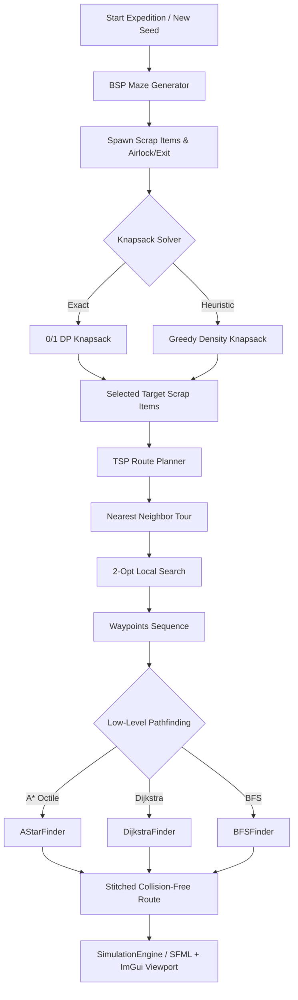
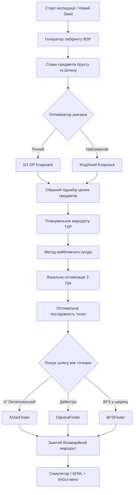

<a id="-english-version"></a>

# 🇬🇧 English Version

> 🌐 **Language:** English &nbsp;|&nbsp; **[🇺🇦 Switch to Ukrainian Version / Перейти до української версії](#-українська-версія)**

---

## 📑 Project Documentation & Guidelines

| Document | Format | Description & Link |
| :--- | :---: | :--- |
| **Individual Assignment** | `DOCX` | 🇺🇦 [`Індивідуальне_завдання_Lethal_Company.docx`](./Індивідуальне_завдання_Lethal_Company.docx) — Approved individual coursework assignment and specifications |
| **Methodological Guidelines** | `PDF` | 🇺🇦 [`guidelines-for-coursework-UA.pdf`](./guidelines-for-coursework-UA.pdf) — Official VNTU DSA coursework requirements and standards |
| **Task Variants Catalog** | `DOCX` | 🇺🇦 [`individual_task_variants.docx`](./individual_task_variants.docx) — Department coursework task variants list |

---

## 🎓 Academic Profile & Metadata

- **Institution:** Vinnytsia National Technical University ([VNTU](https://vntu.edu.ua/))
- **Faculty:** Faculty of Information Technology and Computer Engineering (FITCE)
- **Department:** Department of Software Engineering
- **Program / Major:** 121 Software Engineering
- **Course / Discipline:** Data Structures and Algorithms (DSA)
- **Author:** Yaroslav SYCH, Student of Group 2PI-25b
- **Academic Advisor / Supervisor:** Ph.D. in Engineering, Associate Professor
- **Year & Location:** Vinnytsia, 2026

---

## 🎯 Topic & Project Objectives

### Project Topic

> **"Development and Efficiency Analysis of Discrete Route Optimization and Autonomous Resource Gathering Algorithms in a Grid Complex (Lethal Company DSA Simulator)"**
> *(General theme: "Development and efficiency analysis of algorithms and programs")*

### Background & Gamification Concept

The project simulates an autonomous worker-agent expedition inspired by the popular cooperative game **Lethal Company**. An employee of "The Company" is deployed into an abandoned procedural underground industrial complex to collect high-value scrap items scattered across hazardous terrain, meeting a strict profit quota while operating under bounded energy constraints and backpack payload capacity.

Solving this challenge requires a multi-tier combinatorial optimization pipeline:
1. **Resource Value Maximization:** Solving the 0/1 Knapsack problem to select the optimal subset of scrap items subject to physical weight limits.
2. **Global Tour Planning:** Solving the Traveling Salesperson Problem (TSP) with fixed departure (Airlock) and return/extraction points to determine the optimal sequence of waypoints.
3. **Low-Level Grid Navigation:** Finding energy-efficient, collision-free paths between consecutive waypoints in an 8-directional weighted maze containing mud traps, obstacles, and doorway bottlenecks.

### Key Objectives

1. Design a formal mathematical formulation for the dual-level combinatorial optimization problem.
2. Implement and contrast alternative algorithmic strategies:
   - **0/1 Knapsack Problem:** Exact Dynamic Programming ($O(N \cdot C)$) vs. Heuristic Greedy Density approach ($O(N \log N)$).
   - **Pathfinding on Weighted Graphs:** Heuristic A\* (with Octile distance metric) vs. Dijkstra uniform-cost search vs. Uninformed Breadth-First Search (BFS).
   - **Routing / TSP:** Nearest Neighbor heuristic coupled with 2-Opt local search optimization.
3. Procedurally generate realistic multi-room industrial layouts using **Binary Space Partitioning (BSP)** with guaranteed room reachability, cyclic corridors, and configurable hazard density.
4. Construct an interactive real-time 2D simulation application in **C++20** using **SFML 3** for hardware-accelerated rendering and **Dear ImGui** for developer analytics and control HUD.
5. Provide automatic profiling metrics: execution runtime ($\mu s$), memory consumption (bytes), nodes explored, total path length, total collected scrap value, and energy expenditure.
6. Support batch benchmarking and CSV data export for empirical algorithmic analysis.

---

## 🧩 Algorithmic Architecture & Data Structures



### 1. Optimization Pipeline

| Stage | Algorithm | Complexity (Time / Space) | Implementation Details |
| :--- | :--- | :---: | :--- |
| **Item Selection** | **0/1 Knapsack DP** | $O(N \cdot \min(C, \sum W)) \ /\ O(N \cdot C)$ | Exact optimal solution; memory-bounded allocation with fast-path bypass when total weight $\le$ capacity. |
| **Item Selection** | **Greedy Knapsack** | $O(N \log N) \ /\ O(N)$ | Fast heuristic sorting by value density $V_i / W_i$; handles zero-weight items via infinity density. |
| **Global Tour** | **TSP Nearest Neighbor** | $O(K^2) \ /\ O(K)$ | Greedy order construction between $K$ waypoints with fixed start airlock and return/exit destination. |
| **Global Tour** | **TSP 2-Opt Search** | $O(M \cdot K^2) \ /\ O(K)$ | Local 2-edge exchange optimization; preserves fixed endpoints and handles disconnected graphs safely. |
| **Navigation** | **A\* Pathfinding** | $O(E \log V) \ /\ O(V)$ | 8-directional search with Octile metric $h = 10(dx+dy) - 6\min(dx,dy)$; uses `closedSet` to prune stale queue items. |
| **Navigation** | **Dijkstra Finder** | $O(E \log V) \ /\ O(V)$ | Uniform-cost search exploring equidistant contours; serves as the exact ground truth for path costs. |
| **Navigation** | **BFS Finder** | $O(V + E) \ /\ O(V)$ | Uninformed 8-directional wave flood fill; minimizes hop count regardless of terrain energy costs. |
| **Environment** | **BSP Generator** | $O(R \log R) \ /\ O(W \cdot H)$ | Recursive Binary Space Partitioning; generates industrial rooms, hallways, and extra cyclic loops. |

### 2. Standard Data Structures Mapping

| Abstract Data Structure | C++ Standard Type | Role in the System |
| :--- | :--- | :--- |
| **Dynamic 2D Array** | `std::vector<std::vector<Cell>>` | Discrete grid matrix storing floor, wall, doorway, and mud cell types. |
| **Priority Queue / Min-Heap** | `std::priority_queue<Node, vector<Node>, greater<Node>>` | Open set for A\* and Dijkstra frontier expansion with $O(\log N)$ extraction. |
| **FIFO Queue** | `std::queue<core::Point>` | Wavefront exploration buffer for Breadth-First Search (BFS). |
| **Hash Tables / Sets** | `std::unordered_map`, `std::unordered_set` | Fast $O(1)$ lookups for `gScore`, `cameFrom` parent maps, and closed visited sets. |
| **Matrix DP Table** | `std::vector<std::vector<int>>` | 2D dynamic programming memoization table for knapsack values. |
| **Call Stack / Reversal** | `std::vector<core::Point>` with `std::reverse` | Backtracking path reconstruction from destination back to source. |

---

## 🎮 Interactive Simulation & GUI Features

- **Procedural 2D Grid Engine:** Hardware-accelerated rendering using **SFML 3** with custom tile textures, animated agent sprites, and scrap rarity indicators.
- **Dynamic Camera Controller:** Smooth dragging with Left Mouse Button (<kbd>LMB</kbd>), customizable zoom level ($0.5\times$ to $3.0\times$), and toggleable auto-follow camera.
- **Interactive Radar Minimap:** Scalable top-down minimap overlay in the corner. Clicking anywhere on the minimap instantly centers the viewport.
- **Full Simulation Controls:** Real-time speed slider ($0.5\times$ to $4.0\times$), step-by-step frame advance, history stepping backward, instant finish, and reset.
- **Safety / Evacuation Warnings:** Intelligent monitoring of remaining agent energy relative to maze winding factor and distance to extraction point.
- **Batch Benchmarking Suite:** Automated execution comparing all algorithm combinations ($2 \times 3 = 6$ solver configurations) with CSV metric export.

---

## ⌨️ User Controls & Hotkeys Reference

| Key / Action | Function | Description |
| :---: | :--- | :--- |
| <kbd>Space</kbd> | **Play / Pause** | Toggle simulation real-time playback. |
| <kbd>N</kbd> | **Step Forward** | Advance simulation by exactly one move along the planned path. |
| <kbd>B</kbd> | **Step Backward** | Revert simulation state to the previous historical step. |
| <kbd>R</kbd> | **Reset Agent** | Reset agent position, energy, and backpack to starting conditions. |
| <kbd>F</kbd> | **Instant Finish** | Fast-forward all remaining path steps immediately. |
| <kbd>G</kbd> | **Toggle Grid** | Show or hide tile coordinate grid lines. |
| <kbd>C</kbd> | **Camera Follow** | Toggle automatic camera tracking on the active agent. |
| <kbd>LMB</kbd> Drag (Map) | **Pan Viewport** | Click and drag with left mouse button to pan camera smoothly across the labyrinth. |
| <kbd>LMB</kbd> Click / Drag (Minimap) | **Minimap Navigate** | Click or drag on the radar minimap to reposition viewport camera. |
| <kbd>Mouse Wheel</kbd> | **Zoom** | Smoothly zoom viewport in and out ($0.5\times$ to $3.0\times$). |
| <kbd>Esc</kbd> | **Exit** | Close simulation application window. |

---

## ⚙️ Technical Stack & System Requirements

### Software Stack

- **Language:** C++20 (Standard ISO/IEC 14882:2020)
- **Multimedia & Windowing:** [SFML 3.0.2](https://www.sfml-dev.org/) (Simple and Fast Multimedia Library)
- **Graphical Interface (GUI):** [Dear ImGui](https://github.com/ocornut/imgui) (v1.91+) & [ImGui-SFML](https://github.com/SFML/imgui-sfml)
- **Serialization / Data:** [nlohmann/json](https://github.com/nlohmann/json)
- **Build System:** CMake 3.22+
- **Compiler:** GCC 11+ (MinGW-w64), Clang 13+, or MSVC 2022+

### Minimum System Requirements

- **Operating System:** Windows 10/11 (64-bit), Linux (x86-64), or macOS
- **CPU:** Dual-core x86-64 @ 2.0 GHz or higher
- **RAM:** 4 GB RAM (Application uses $< 70$ MB)
- **GPU:** OpenGL 3.0 / DirectX 11 compatible graphics card
- **Storage:** 50 MB free disk space

---

## 📁 Directory Structure

```text
course-projects/DSA-cpp/
├── CMakeLists.txt                         # CMake build script
├── README.md                              # 📖 Project Documentation (Bilingual: EN / UA)
├── guidelines-for-coursework-UA.pdf       # Methodological Guidelines (Ukrainian)
├── individual_task_variants.docx          # Department Coursework Variants Catalog
├── Індивідуальне_завдання_Lethal_Company.docx # Approved Individual Assignment
├── assets/                                # 🎨 Application visual assets & icons
│   ├── app.rc                             # Windows resource definition script
│   ├── icon.ico                           # Executable icon
│   ├── icon.png                           # High-res application icon
│   ├── map.png                            # Floor texture background
│   └── cursor-grabbing*.png               # Camera drag cursors
├── include/                               # 📦 C++ Header-only architecture
│   ├── algorithms/                        # Core algorithmic solvers
│   │   ├── knapsack/                      # Knapsack strategies
│   │   │   ├── IKnapsackSolver.hpp        # Knapsack solver interface
│   │   │   ├── DPKnapsack.hpp             # 0/1 Dynamic Programming solver
│   │   │   └── GreedyKnapsack.hpp         # Value-density heuristic solver
│   │   ├── pathfinding/                   # Grid pathfinding strategies
│   │   │   ├── IPathfinder.hpp            # Pathfinder interface
│   │   │   ├── AStarFinder.hpp            # A* with Octile metric & closedSet
│   │   │   ├── DijkstraFinder.hpp         # Uniform-cost Dijkstra search
│   │   └── routing/                       # Global route optimization
│   │       ├── RoutePlan.hpp              # Route plan data structure & metrics
│   │       └── TSPSolver.hpp              # TSP Nearest Neighbor + 2-Opt solver
│   ├── core/                              # Fundamental data structures
│   │   ├── Backpack.hpp                   # Agent inventory & capacity manager
│   │   ├── Config.hpp                     # Simulation configuration & limits
│   │   ├── Item.hpp                       # Scrap template catalog & item model
│   │   └── Types.hpp                      # Points, directions, coordinates, enums
│   ├── io/                                # Input / Output utilities
│   │   └── CsvExporter.hpp                # Benchmark CSV exporter
│   ├── map/                               # Procedural labyrinth model
│   │   ├── BSPGenerator.hpp               # Binary Space Partitioning generator
│   │   ├── Cell.hpp                       # Tile model (Floor, Wall, Door, Mud)
│   │   ├── Maze.hpp                       # Grid container, neighbors, path cost
│   │   └── Room.hpp                       # BSP room bounding box geometry
│   ├── simulation/                        # Runtime simulation engine
│   │   ├── Agent.hpp                      # Autonomous agent state, energy, steps
│   │   └── SimulationEngine.hpp           # State machine, history stepping, safety
│   └── ui/                                # User Interface & Rendering
│       ├── CameraController.hpp           # Pan & zoom viewport controller
│       ├── ImGuiOverlay.hpp               # Dear ImGui HUD & control panels
│       ├── Minimap.hpp                    # Real-time radar minimap component
│       └── ProceduralRenderer.hpp         # SFML tile & sprite grid renderer
└── src/                                   # 💻 C++ Implementation source files
    ├── main.cpp                           # Application entry point & game loop
    └── map/
        └── BSPGenerator.cpp               # BSP generation implementation
```

---

## 🚀 Building & Running the Project

### 1. Prerequisites

Ensure you have CMake (3.22+) and a modern C++20 compiler installed (MinGW-w64 GCC 13+ recommended for Windows). SFML 3.0.2 should be present on your system (e.g. at `E:/Dev/Dependencies/SFML-3.0.2` or specified via `-DCMAKE_PREFIX_PATH`).

### 2. Configure & Build via CLI

```bash
# Clone or navigate to the repository
cd course-projects/DSA-cpp

# Create and enter build directory
cmake -B build -G "MinGW Makefiles" -DCMAKE_BUILD_TYPE=Release

# Compile the target executable
cmake --build build --config Release -j4
```

### 3. Run the Application

```bash
# Launch the compiled executable
./build/LethalCompanyDSA.exe
```

All required SFML runtime DLLs and asset files are automatically copied into `build/` during the CMake post-build step.

---

<br />

---

<a id="-українська-версія"></a>

# 🇺🇦 Українська версія

> 🌐 **Мова:** Українська &nbsp;|&nbsp; **[🇬🇧 Switch to English Version / Перейти до англійської версії](#-english-version)**

---

## 📑 Документація курсового проєкту та методичні матеріали

| Документ | Формат | Опис та пряме посилання |
| :--- | :---: | :--- |
| **Індивідуальне завдання** | `DOCX` | 🇺🇦 [`Індивідуальне_завдання_Lethal_Company.docx`](./Індивідуальне_завдання_Lethal_Company.docx) — Затверджене індивідуальне завдання та вимоги кафедри |
| **Методичні вказівки кафедри** | `PDF` | 🇺🇦 [`guidelines-for-coursework-UA.pdf`](./guidelines-for-coursework-UA.pdf) — Офіційні методичні вказівки ВНТУ з дисципліни АСД |
| **Каталог варіантів завдань** | `DOCX` | 🇺🇦 [`individual_task_variants.docx`](./individual_task_variants.docx) — Збірник тем та варіантів курсових робіт |

---

## 🎓 Академічний профіль та метадані

- **Заклад вищої освіти:** Вінницький національний технічний університет ([ВНТУ](https://vntu.edu.ua/))
- **Факультет:** Факультет інформаційних технологій та комп'ютерної інженерії (ФІТКІ)
- **Кафедра:** Кафедра програмної інженерії
- **Спеціальність:** 121 «Інженерія програмного забезпечення»
- **Освітньо-професійна програма:** «Програмна інженерія»
- **Дисципліна:** «Алгоритми та структури даних» (АСД)
- **Виконавець:** студент групи 2ПІ-25б, **Сич Ярослав Олександрович**
- **Керівник проєкту:** к.т.н., доцент кафедри ПІ
- **Рік та місце виконання:** Вінниця, 2026

---

## 🎯 Тема, мета та завдання курсового проєкту

### Тема роботи

> **«Розробка та дослідження ефективності алгоритмів дискретної оптимізації маршруту та збору ресурсів у сітковому лабіринті (Симулятор Lethal Company DSA)»**
> *(Загальна тема: «Розробка й аналіз ефективності алгоритмів і програм»)*

### Актуальність та концепція гейміфікації

Проєкт моделює роботу автономного агента-експерта у стилістиці популярної гри **Lethal Company**. Співробітник корпорації висаджується в покинутому процедурно згенерованому підземному комплексі для збору цінних ресурсів (металобрухту). Агент має обмежений запас автономної енергії, лімітовану вантажопідйомність рюкзака та повинен виконати корпоративну квоту мінімального прибутку, повернувшись до точки шлюзу.

Розв'язання поставленої задачі вимагає дворівневого комбінаторного оптимізаційного пайплайну:
1. **Оптимізація вибору ресурсів:** Розв'язання задачі про рюкзак (Knapsack Problem) для максимізації вартості вантажу в межах граничної ваги.
2. **Оптимізація черговості обходу:** Розв'язання задачі комівояжера (TSP) із фіксованими точками старту та евакуації для мінімізації загальної довжини туру.
3. **Низькорівнева навігація в сітці:** Пошук енергетично найвигідніших траєкторій без колізій на 8-зв'язному зваженому графі лабіринту з урахуванням стін, дверей та багнистих ділянок.

### Основні завдання проєкту

1. Розробити формальну математичну модель комплексної оптимізаційної задачі.
2. Реалізувати та порівняти альтернативні алгоритмічні підходи:
   - **Задача про рюкзак:** Точний алгоритм динамічного програмування ($O(N \cdot C)$) проти наближеного жадібного алгоритму за питомою цінністю ($O(N \log N)$).
   - **Пошук шляху на графах:** Евристичний алгоритм A\* (з октагональною метрикою) проти алгоритму Дейкстри (рівномірний пошук за вартістю) та неінформованого пошуку в ширину (BFS).
   - **Маршрутизація TSP:** Метод найближчого сусіда (Nearest Neighbor) із локальною оптимізацією 2-Opt.
3. Реалізувати процедурну генерацію лабіринту алгоритмом **BSP (Binary Space Partitioning)** із гарантованою досяжністю кімнат, циклічними коридорами та генерацією ділянок болота.
4. Створити графічний інтерфейс користувача мовою **C++20** на базі бібліотек **SFML 3** (апаратний рендеринг) та **Dear ImGui** (аналітичний HUD та керування).
5. Забезпечити вимірювання ключових характеристик: часу виконання ($\mu s$), пам'яті (байти), кількості розкритих вузлів, довжини шляху, вартості зібраного вантажу та витраченої енергії.
6. Реалізувати модуль автоматичного бенчмаркінгу з експортом метрик у CSV.

---

## 🧩 Алгоритмічна архітектура та структури даних



### 1. Порівняльна характеристика реалізованих алгоритмів

| Етап | Алгоритм | Складність (Час / Пам'ять) | Особливості реалізації |
| :--- | :--- | :---: | :--- |
| **Вибір брухту** | **0/1 Knapsack DP** | $O(N \cdot \min(C, \sum W)) \ /\ O(N \cdot C)$ | Точний глобальний оптимум; безпечне виділення пам'яті та миттєвий результат, якщо всі предмети вміщуються в рюкзак. |
| **Вибір брухту** | **Greedy Knapsack** | $O(N \log N) \ /\ O(N)$ | Швидке сортування за питомою цінністю $V_i / W_i$; пріоритетна обробка предметів нульової ваги через `infinity`. |
| **Тур TSP** | **TSP Nearest Neighbor** | $O(K^2) \ /\ O(K)$ | Жадібна побудова ланцюжка між $K$ точками з фіксованими точками старту та евакуації; безпечна обробка ізольованих вершин. |
| **Тур TSP** | **TSP 2-Opt Search** | $O(M \cdot K^2) \ /\ O(K)$ | Локальна оптимізація обміну 2 ребер; захист від нескінченної вартості ребер при частковій недосяжності. |
| **Навігація** | **A\* Pathfinding** | $O(E \log V) \ /\ O(V)$ | 8-напрямковий пошук з октагональною евристикою $h = 10(dx+dy) - 6\min(dx,dy)$; `closedSet` усуває дублікати та застарілі записи. |
| **Навігація** | **Алгоритм Дейкстри** | $O(E \log V) \ /\ O(V)$ | Рівномірний пошук за мінімальною вартістю енергії; еталон точності вартості переходів. |
| **Навігація** | **Пошук у ширину (BFS)** | $O(V + E) \ /\ O(V)$ | Неінформований хвильовий пошук; знаходить шлях із найменшою кількістю кроків без врахування вартості покриття. |
| **Топологія** | **Генератор BSP** | $O(R \log R) \ /\ O(W \cdot H)$ | Двійкове розбиття простору з вирубкою кімнат, сполучних коридорів та додаткових циклічних петель. |

### 2. Використані базові структури даних

| Абстрактна структура даних | Контейнер у C++20 | Застосування в проєкті |
| :--- | :--- | :--- |
| **Динамічний 2D масив** | `std::vector<std::vector<Cell>>` | Матриця комірок лабіринту (стіни, підлога, шлюз, вихід, болото). |
| **Бінарна купа (Min-Heap)** | `std::priority_queue<Node, vector<Node>, greater<Node>>` | Черга з пріоритетом для швидкого отримання вузла з найменшим $f$ або $g$ у A\* та Дейкстрі. |
| **Черга FIFO** | `std::queue<core::Point>` | Черга для покрокового хвильового обходу графа у BFS. |
| **Хеш-таблиці / Множини** | `std::unordered_map`, `std::unordered_set` | Збереження відстаней `gScore`, батьківських вузлів `cameFrom` та відвіданих клітинок за $O(1)$. |
| **Матриця значень DP** | `std::vector<std::vector<int>>` | Таблиця динамічного програмування для розв'язання задачі про рюкзак. |
| **Стек / Вектор предків** | `std::vector<core::Point>` із `std::reverse` | Відновлення знайденого ланцюжка кроків від фінішу до старту. |

---

## 🎮 Інтерактивна симуляція та графічний інтерфейс

- **Процедурний графічний рушій:** Апаратне прискорення через **SFML 3**, текстурована сітка кімнат, анімований спрайт агента та каталог із 30 автентичних предметів брухту Lethal Company.
- **Динамічна камера:** Плавне переміщення лівою кнопкою миші (<kbd>ЛКМ</kbd>), масштабування колесом миші ($0.5\times$ – $3.0\times$) та режим авто-слідкування за персонажем.
- **Інтерактивна міні-карта:** Радар комплексу у кутку екрана. Клік по міні-карті миттєво центрує камеру на обраній точці комплексу.
- **Повне керування процесом симуляції:** Слайдер швидкості ($0.5\times$ – $4.0\times$), покроковий хід уперед/назад, миттєве завершення та скидання до старту.
- **Інтелектуальна система безпеки:** Розрахунок мінімальної енергії до точки евакуації з урахуванням звивистості коридорів лабіринту та завчасний перехід у стан `Evacuating`.
- **Модуль пакетного тестування (Batch Benchmark):** Одночасний запуск усіх 6 комбінацій алгоритмів із побудовою підсумкової порівняльної таблиці та експортом у CSV.

---

## ⌨️ Керування та гарячі клавіші

| Клавіша / Дія | Призначення | Опис дії |
| :---: | :--- | :--- |
| <kbd>Пробіл</kbd> | **Старт / Пауза** | Зупинити або продовжити рух агента в реальному часі. |
| <kbd>N</kbd> | **Крок уперед** | Виконати один дискретний крок уздовж побудованого маршруту. |
| <kbd>B</kbd> | **Крок назад** | Відкотити стан симуляції та енергії на один крок назад за історією. |
| <kbd>R</kbd> | **Скинути агента** | Повернути агента на початкову точку зі стартовим рівнем енергії. |
| <kbd>F</kbd> | **Миттєвий фініш** | Пройти весь залишок маршруту миттєво. |
| <kbd>G</kbd> | **Сітка** | Увімкнути/вимкнути відображення ліній сітки між комірками. |
| <kbd>C</kbd> | **Автокамера** | Увімкнути/вимкнути фокусування камери на агенті під час руху. |
| <kbd>ЛКМ</kbd> перетягування (Карта) | **Панорамування** | Затиснути ліву кнопку миші для плавного переміщення камери лабіринтом. |
| <kbd>ЛКМ</kbd> клік / перетягування (Міні-карта) | **Навігація міні-картою** | Клік або перетягування по радару для миттєвого центрування камери. |
| <kbd>Колесо миші</kbd> | **Зум** | Наближення та віддалення камери ($0.5\times$ – $3.0\times$). |
| <kbd>Esc</kbd> | **Вихід** | Закрити вікно застосунку. |

---

## ⚙️ Системні вимоги та стек технологій

### Програмний стек

- **Мова програмування:** C++20 (стандарт ISO/IEC 14882:2020)
- **Графічний рушій та вікно:** [SFML 3.0.2](https://www.sfml-dev.org/) (Simple and Fast Multimedia Library)
- **Графічний інтерфейс (GUI):** [Dear ImGui](https://github.com/ocornut/imgui) (v1.91+) та [ImGui-SFML](https://github.com/SFML/imgui-sfml)
- **Обробка даних:** [nlohmann/json](https://github.com/nlohmann/json)
- **Система збірки:** CMake 3.22+
- **Компілятор:** GCC 11+ (MinGW-w64), Clang 13+, або MSVC 2022+

### Апаратні вимоги

- **Операційна система:** Windows 10/11 (64-bit), Linux (x86-64), macOS
- **Процесор:** 2-ядерний процесор з частотою від 2.0 ГГц
- **Оперативна пам'ять:** 4 ГБ RAM (застосунок споживає $< 70$ МБ)
- **Відеокарта:** Адаптер з підтримкою OpenGL 3.0 / DirectX 11
- **Дисковий простір:** 50 МБ вільного місця

---

## 📁 Структура каталогу

```text
course-projects/DSA-cpp/
├── CMakeLists.txt                         # Конфігурація збірки CMake
├── README.md                              # 📖 Документація проєкту (Bilingual: EN / UA)
├── guidelines-for-coursework-UA.pdf       # Методичні вказівки кафедри (Українська)
├── individual_task_variants.docx          # Збірник варіантів завдань кафедри
├── Індивідуальне_завдання_Lethal_Company.docx # Затверджене індивідуальне завдання
├── assets/                                # 🎨 Графічні ресурси, текстури та іконка
│   ├── app.rc                             # Скрипт ресурсів програми (Windows)
│   ├── icon.ico                           # Іконка виконуваного файлу
│   ├── icon.png                           # Графічна іконка вікна
│   ├── map.png                            # Текстура фону комплексу
│   └── cursor-grabbing*.png               # Спрайти курсорів перетягування
├── include/                               # 📦 Заголовні файли C++ (Header-only архітектура)
│   ├── algorithms/                        # Реалізації алгоритмів
│   │   ├── knapsack/                      # Алгоритми задачі про рюкзак
│   │   │   ├── IKnapsackSolver.hpp        # Інтерфейс оптимізатора рюкзака
│   │   │   ├── DPKnapsack.hpp             # Точний алгоритм динамічного програмування
│   │   │   └── GreedyKnapsack.hpp         # Наближений жадібний алгоритм за щільністю
│   │   ├── pathfinding/                   # Алгоритми пошуку найкоротшого шляху
│   │   │   ├── IPathfinder.hpp            # Інтерфейс алгоритмів навігації
│   │   │   ├── AStarFinder.hpp            # A* з октагональною евристикою та closedSet
│   │   │   ├── DijkstraFinder.hpp         # Алгоритм Дейкстри
│   │   │   └── BFSFinder.hpp              # Неінформований пошук у ширину (BFS)
│   │   └── routing/                       # Глобальне планування маршруту
│   │       ├── RoutePlan.hpp              # Структури даних плану маршруту та метрик
│   │       └── TSPSolver.hpp              # Розв'язувач TSP (Nearest Neighbor + 2-Opt)
│   ├── core/                              # Базові структури та типи
│   │   ├── Backpack.hpp                   # Модель рюкзака та перевірка місткості
│   │   ├── Config.hpp                     # Налаштування розмірів, енергії та квот
│   │   ├── Item.hpp                       # Каталог із 30 предметів брухту
│   │   └── Types.hpp                      # Координати Point, напрямки, переліки
│   ├── io/                                # Модулі вводу/виводу
│   │   └── CsvExporter.hpp                # Експортер результатів бенчмарків у CSV
│   ├── map/                               # Модель лабіринту
│   │   ├── BSPGenerator.hpp               # Генератор лабіринту методом BSP
│   │   ├── Cell.hpp                       # Модель клітинки (Підлога, Стіна, Двері, Болото)
│   │   ├── Maze.hpp                       # Контейнер сітки, перевірка прохідності
│   │   └── Room.hpp                       # Геометрія кімнат BSP
│   ├── simulation/                        # Рушій симуляції
│   │   ├── Agent.hpp                      # Стан, кроки та енергія робітника
│   │   └── SimulationEngine.hpp           # Машина станів, покроковий відкат та безпека
│   └── ui/                                # Підсистема графічного інтерфейсу
│       ├── CameraController.hpp           # Керування камерою (панорамування, зум)
│       ├── ImGuiOverlay.hpp               # Панелі налаштувань та HUD на Dear ImGui
│       ├── Minimap.hpp                    # Компонент динамічної міні-карти
│       └── ProceduralRenderer.hpp         # Процедурний рендерер сітки та спрайтів
└── src/                                   # 💻 Вихідний код реалізації
    ├── main.cpp                           # Головна точка входу та ігровий цикл
    └── map/
        └── BSPGenerator.cpp               # Реалізація алгоритму BSP генерації
```

---

## 🚀 Збірка та запуск проєкту

### 1. Попередні вимоги

Переконайтеся, що у системі встановлено CMake (версії 3.22+) та сучасний компілятор із підтримкою стандарту C++20 (наприклад, MinGW-w64 GCC 13+ або MSVC 2022). Також має бути встановлена бібліотека SFML 3.0.2 (наприклад, за шляхом `E:/Dev/Dependencies/SFML-3.0.2` або через передачу `-DCMAKE_PREFIX_PATH`).

### 2. Конфігурація та збірка через командний рядок

```bash
# Перейти до каталогу курсового проєкту
cd course-projects/DSA-cpp

# Генерація файлів збірки CMake у режимі Release
cmake -B build -G "MinGW Makefiles" -DCMAKE_BUILD_TYPE=Release

# Компіляція виконуваного файлу
cmake --build build --config Release -j4
```

### 3. Запуск застосунку

```bash
# Запуск скомпільованого бінарника
./build/LethalCompanyDSA.exe
```

Усі необхідні динамичні бібліотеки (`*.dll`) SFML та графічні ресурси автоматично копіюються в папку `build/` на етапі постобробки CMake (`POST_BUILD`).
